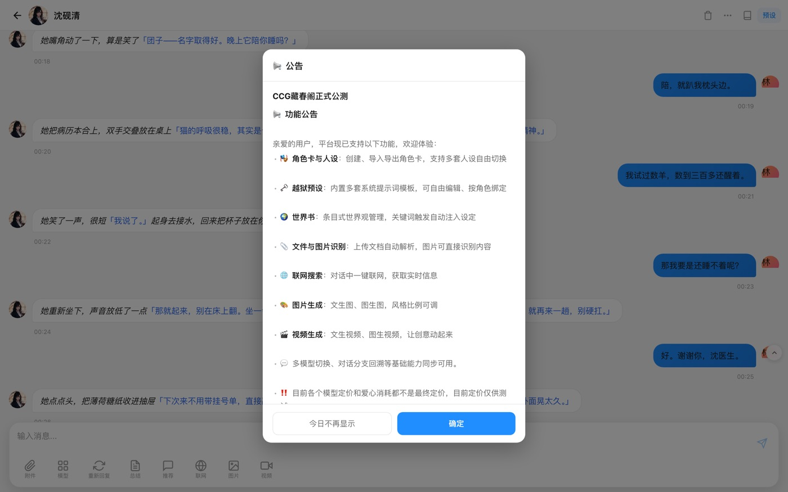
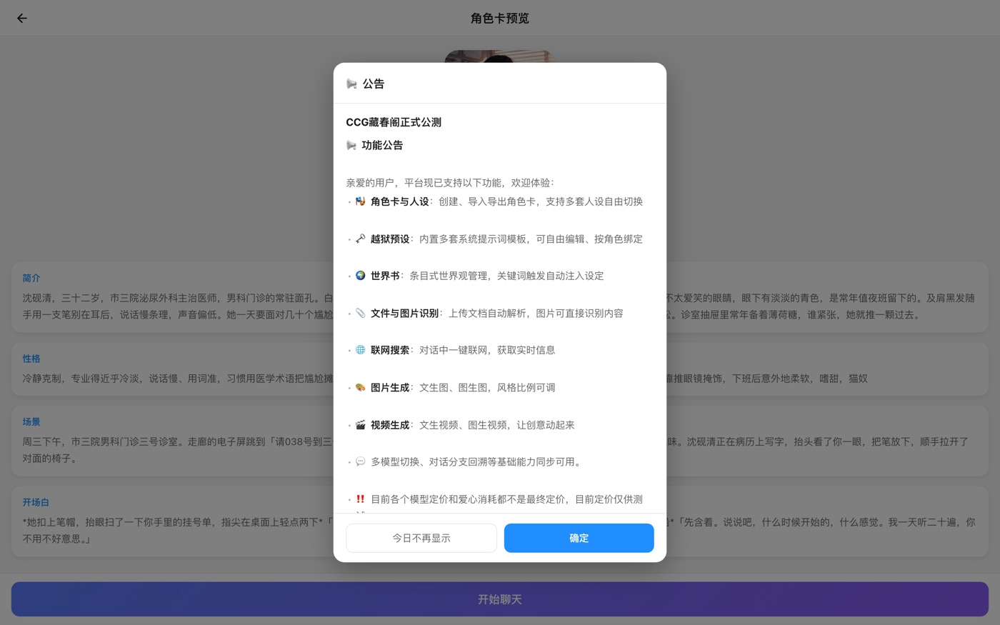
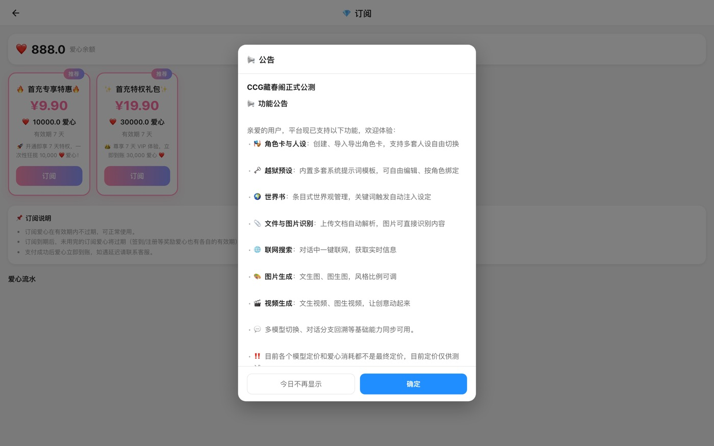
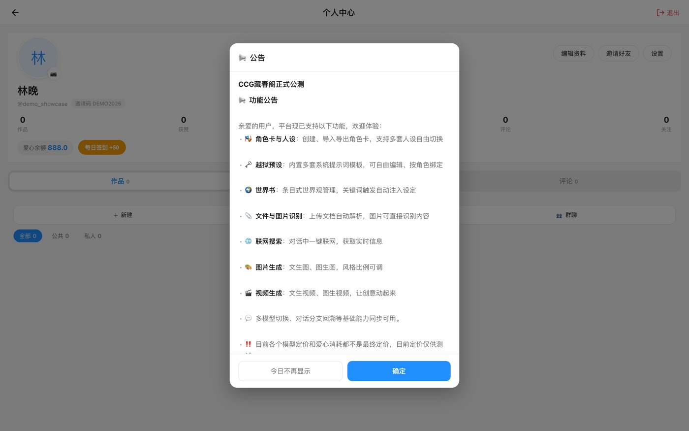
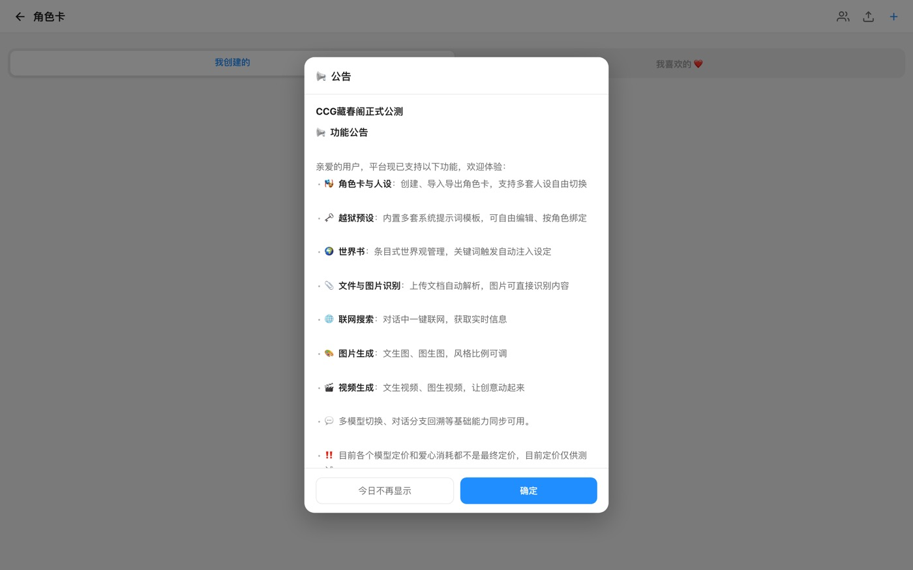
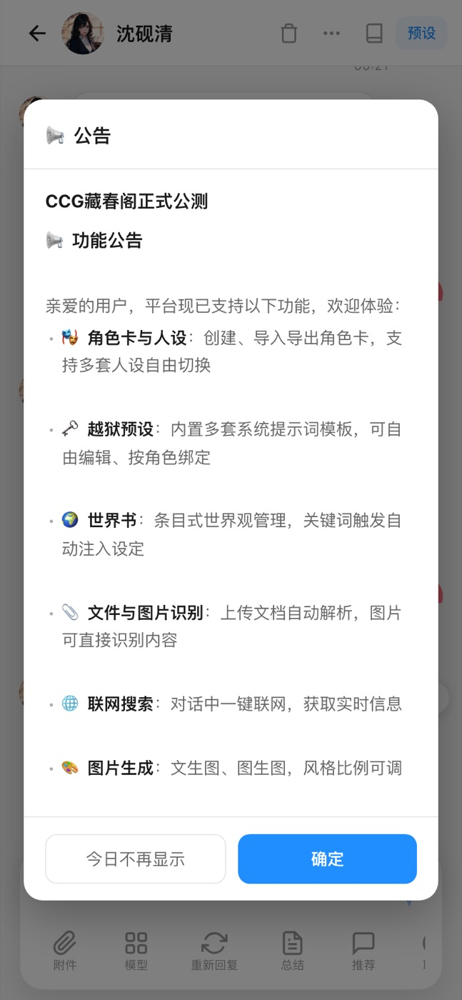
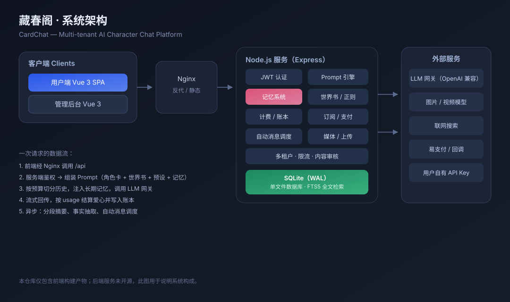

<div align="center">

# 🌸 CardChat (藏春阁)

**A multi-tenant AI character roleplay platform you can actually run.**

[中文](README.md) · [English](README.en.md) · [日本語](README.ja.md)

Live demo → **https://ccg.officechat.com.cn**

</div>

---

## What it is

CardChat is a complete, operable platform for AI character roleplay. Users create or import character cards
and hold long-running conversations with them. The platform handles model access, context assembly, long-term
memory, content safety and a coin-based billing system, while admins moderate and configure everything from a
management console.

The hard parts are all on the server side:

- **Context engineering** — character cards, world books, presets, regex scripts, quoted replies and memory
  blocks, assembled under a token budget
- **Long-term memory** — layered compression, fact extraction and hybrid retrieval, so a character still
  remembers you dozens of turns later
- **Multi-tenant billing** — platform keys and bring-your-own-key in parallel, exact usage-based settlement,
  subscriptions and coins side by side
- **Operable** — review queues, orders, ledgers, subscriptions, announcements and platform configuration

> This repository contains **only the frontend build (obfuscated)** for showcase and distribution.
> The backend source is not public. The feature documentation below covers the full stack.

---

## Screenshots

<table>
  <tr>
    <td width="50%"></td>
    <td width="50%"></td>
  </tr>
  <tr>
    <td align="center"><sub>Discover · tag filters and recommendations</sub></td>
    <td align="center"><sub>Chat · streaming replies, actions, multiple branches</sub></td>
  </tr>
  <tr>
    <td width="50%"></td>
    <td width="50%"></td>
  </tr>
  <tr>
    <td align="center"><sub>Character card · profile, tags, likes, start chatting</sub></td>
    <td align="center"><sub>Subscription · balance, plans, payment</sub></td>
  </tr>
  <tr>
    <td width="50%"></td>
    <td width="50%"></td>
  </tr>
  <tr>
    <td align="center"><sub>Profile · check-in, invites, works and stats</sub></td>
    <td align="center"><sub>Character management · create / import / group</sub></td>
  </tr>
</table>

<p align="center">
  
  <br>
  <sub>Mobile · fully responsive</sub>
</p>

---

## Architecture

<p align="center">
  
</p>

| Layer | Choice |
|---|---|
| Frontend | Vue 3 · TypeScript · Vite · SSE streaming rendering |
| Backend | Node.js (22/24) · Express · TypeScript |
| Database | SQLite (WAL) · `node:sqlite` · FTS5 full-text search (trigram) |
| Model access | Any OpenAI-compatible gateway, streaming with non-streaming fallback |
| Deployment | Docker Compose (server + web) · Nginx reverse proxy |

Deliberate trade-offs:

- **Single process + SQLite** — no Redis/MySQL to babysit at small-to-medium scale; WAL handles concurrent
  reads and writes; a backup is just a file copy
- **Keys live on the server** — the frontend never sees a secret; users may supply their own key and skip coins
- **Sync streaming, async memory** — replies stream instantly while summaries and fact extraction run in a
  background scheduler

---

## Features

### 1. Character cards & content

| Feature | Description |
|---|---|
| Visual card creation | Name, avatar, description, personality, first message, example dialogue, tags, world book binding |
| PNG import / export | SillyTavern v2 compatible, JSON embedded in the image |
| Public / private | Publish to the discover feed or keep it to yourself |
| Moderation | Public cards go through an admin review queue with reject reasons |
| Likes & favourites | Like counters and a personal favourites list |
| Comments | Per-card comment threads with deletion |
| Downloads & popularity | Download counters, chat counts, trending order |
| Creator pages | Author profile with works and stats |
| Leaderboards | Ranked by heat, likes or chat count |
| Preview page | Read the full persona and opening without starting a chat |
| Tag taxonomy | Romance, healing, workplace, mature, fantasy, horror, RPG, anime, etc. |

### 2. Chat engine

| Feature | Description |
|---|---|
| SSE streaming | Token-by-token output with low first-token latency and stop support |
| Regenerate | Re-answer the last reply |
| Branches (swipe) | Multiple candidate replies per turn, switch left/right, stored independently |
| Edit & resend | Edit a past message and regenerate downstream |
| Quoted replies | Quote any message; the server expands it into context |
| Image attachments | Send images, understood by multimodal models |
| Structured blocks | Structured data in messages renders separately from prose |
| Group chat | Several characters in one conversation, @-mention to pick a speaker |
| Personas | Save multiple user identities and switch at any time |
| Presets (jailbreak) | Built-in system prompt templates, editable, bound per conversation, toggle per entry |
| World books | Global / character-embedded / per-conversation, keyword triggered |
| Regex scripts | Display-layer regex replacement (de-AI-ifying, formatting) with scope and priority |
| Export | Export a conversation as text or JSON |
| Message actions | Copy, delete, retry, jump to top/bottom |
| History paging | Load older messages on scroll instead of fetching everything |

### 3. Long-term memory (the core)

The longer a chat runs, the more expensive context becomes. Memory splits "what to remember" into layers and
buys the longest memory possible within a fixed token budget:

| Layer | What it does | Cost |
|---|---|---|
| **L1 working memory** | Slice the most recent raw messages by token budget and message cap | Fixed per turn |
| **L2 chunk summaries** | Every 30 messages or 6,000 chars, generate one summary in the background — never recomputed | One call per chunk |
| **L3 fact cards** | Extract identity / preference / relationship / event facts from summaries, deduplicated | Produced with L2 |
| **Retrieval** | Keyword retrieval against the current input, injecting matching past snippets | One local query per turn |

Other details:

- **No truncation, no injection** — if the history already fits the budget, no memory block is added
- **Per-sentence keyword rotation** — a single long sentence cannot eat the whole keyword quota, so short but
  critical words ("peanut allergy") are still retrievable
- **Fact deduplication** — 2-gram similarity plus longest common substring merges near-duplicates instead of
  repeating "the cat is named Coalball" six times
- **Per-conversation toggle** — on by default, users can switch it off in chat
- **Failed summaries are not persisted** — the pointer does not advance, and the next sweep retries

Measured on real conversations: **~35% fewer prompt tokens** in long-reply scenarios, while the character
still recalls facts that were pushed out of the window.

### 4. Media

| Feature | Description |
|---|---|
| Text-to-image | Scene images generated from the current situation, with prompt enhancement |
| Image-to-video | Short clips with selectable duration, priced in coins |
| Image understanding | Multimodal models read user-sent images |
| Web search | Live search injected into context on demand |
| Client-side compression | Images are compressed before upload to save bandwidth and storage |

### 5. Coins & subscriptions

| Feature | Description |
|---|---|
| Coin balance | Every paid capability is priced in coins |
| Daily check-in | Once a day, configurable reward |
| Invites | Invite-code signup rewards both sides |
| Top-ups | Payment provider integration, tiered packages, async callback reconciliation |
| Subscriptions | Monthly/yearly plans with discounts or quotas |
| Exact billing | Settled from the model's reported usage, not estimates |
| Idempotent ledger | Unique `(user, type, ref)` index, so duplicate callbacks never double-charge |
| Expiry | Configurable validity period for coins |
| Ledger view | Users can inspect every credit and debit |
| Insufficient-balance UX | Shows the balance and three ways out: check-in, top-up, or use your own key |
| Bring your own key | Users can run on their own quota and skip coins entirely |

### 6. Users & social

| Feature | Description |
|---|---|
| Sign up / in | Username, password and captcha, with room for bot checks |
| Profile | Edit details, upload avatar, stats (works / likes / favourites / comments / follows) |
| Notifications | System notices, review results, interaction alerts |
| Announcements | Published from the admin panel, shown as banners and lists |
| Follow creators | Follow authors to see their new works |
| i18n | Simplified Chinese, English, Japanese, Korean, French, Spanish |
| Theming | Light/dark, mobile-first layout, safe-area handling |

### 7. Admin console

| Module | Capabilities |
|---|---|
| Dashboard | Users, cards, message volume, revenue |
| Users | Search, ban/unban, adjust balance, inspect details |
| Card review | Pending queue, approve or reject with a reason |
| Comments | Inspect and delete abusive comments |
| Orders | Top-up orders, statuses, reconciliation |
| Ledger | Site-wide coin ledger queries |
| Subscriptions | Plan configuration and per-user subscription records |
| Platform config | Models and gateways, pricing, registration switch, reward parameters, image/video/search settings |
| Presets | Create, edit, publish or retire built-in presets |
| Announcements / notices | Publish announcements and push targeted notifications |

---

## Backend capabilities

The backend is not open source; this section describes what it actually does so the system's completeness can
be evaluated.

1. **Auth & tenant isolation** — JWT, bcrypt, captcha, rate limiting; every query is scoped by `user_id`.
2. **Model access** — OpenAI-compatible, platform key or user key, streaming with non-streaming fallback, and
   content-level guards against gateways that return errors inside HTTP 200 bodies.
3. **Prompt engine** — system prompt → character card → world book scan → preset entries → persona → memory
   block → recent history → user input, with SillyTavern macros, quoted-reply expansion and token budgeting.
4. **Memory service** — background sweeps, dedicated summary model, FTS5 trigram index with LIKE fallback,
   character-budgeted injection.
5. **Billing** — exact usage-based coins, idempotent ledger, subscription credits, and balance checks placed
   before the user message is written so a rejected send leaves no orphan message.
6. **Auto messages** — a scheduler that proactively messages idle conversations, fully billed and memory-aware,
   with guards against empty replies.
7. **Safety** — keyword/rule moderation, upload validation, human review of public content, report handling.
8. **Payments** — order creation, signature verification, async callbacks, order state machine.
9. **Admin API** — 32 endpoints covering users, cards, comments, orders, ledger, subscriptions, config,
   announcements, notices and presets.

---

## Repository layout

```
.
├── README.md                 # Chinese (default)
├── README.en.md              # English
├── README.ja.md              # Japanese
├── docs/
│   ├── architecture.svg
│   └── images/
├── web/                      # obfuscated frontend build (static hosting ready)
│   ├── index.html
│   └── assets/
└── LICENSE
```

`web/` is a standard static build. It is a single-page app, so unknown paths must fall back to `index.html`
(`try_files $uri /index.html` in Nginx), and a backend API is required for login and chatting.

---

## About the frontend code

- `web/` is a **production build**: no source maps, no comments, mangled identifiers, plus string-array encoding
  and control-flow obfuscation
- Obfuscation applies to the build only; startup, routing and rendering are verified working
- Original Vue sources, backend sources, database schema and operational configuration are **not** included
- For custom development, private deployment or feature work, please get in touch

---

## License

**All Rights Reserved.** See [LICENSE](LICENSE).

- You may view and download this repository for learning and evaluation
- Commercial use, redistribution, or deploying it as a public service requires written permission
- Project name, UI design and copy belong to the author

---

<div align="center">
<sub>Made with 🌸 · Star it if it inspires you</sub>
</div>
